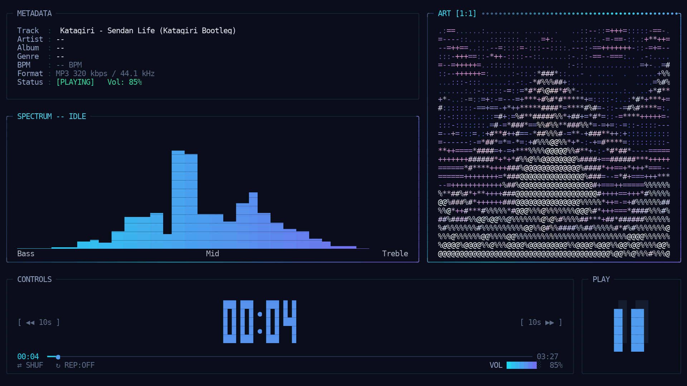

# QPanel


A standalone terminal music player: rounded chassis, Hyprland-style gradient
borders, a chafa cover-art panel, an FFT spectrum that takes over when you stop
touching the mouse, and a transport deck. No daemon, no database — point it at
a folder and it plays.



The mark, animated (5.8 s, greyscale so it survives any terminal theme):
[`docs/logo.mp4`](docs/logo.mp4)

```
qpanel [DIR] [options]
```

## Build

Needs CMake ≥ 3.24, a C++20 compiler, `taglib`, `fftw3f` and `pkg-config`.
`libchafa` + `glib-2.0` are optional: if the headers in `vendor/chafa` and the
runtime `libchafa.so.0` are present the chafa art engine is used, otherwise the
built-in half-block renderer takes over (same UI, simpler art).

```sh
cmake -S . -B build
cmake --build build -j8
./build/qpanel ~/Music
```

ASan build used for testing:

```sh
cmake -S . -B build-asan -DCMAKE_BUILD_TYPE=Debug \
      -DCMAKE_CXX_FLAGS="-fsanitize=address -g"
cmake --build build-asan -j8
```

## Keys

| key | action |
| --- | --- |
| w + arrow | move the highlight between the docks |
| ↑ / ↓ | tree selection while BROWSER is focused, volume on any other dock |
| ← / → | seek −10s / +10s |
| + / − (hold) | speed up / slow down while held, back to 1x on release |
| space / p | play-pause |
| enter | play selection / expand folder |
| s | shuffle |
| r | repeat off → all → one |
| ctrl+9 (or ctrl+0) | reload `config.ini` live |
| q | quit |

Arrow keys keep driving the transport while the spectrum is up — the tree is
hidden then, so there is nothing to navigate.

## Mouse

* click a track — play it, click a folder — expand/collapse, double-click — play
* drag the scrub bar — seek, drag the volume bar — volume, wheel over it — ±5%
* click **METADATA** or **ART** — focus that dock and bring the spectrum up
* click the **BROWSER/SPECTRUM** dock — back to the tree
* the **CONTROLS** and **PLAY** docks stay transport-only

After `idle_timeout` seconds without input the browser dock fades into the
spectrum on its own and dissolves back on the next click or key.

## Config

```sh
qpanel --print-config   # commented skeleton on stdout
qpanel --write-config   # ~/.config/qpanel/config.ini
```

Sections: `[general]` theme / icons / volume / idle_timeout, `[layout]` gaps,
padding, border style, shadow, art panel, `[art]` chafa engine settings and the
ASCII ramp, `[colors]` per-theme hex overrides. Command-line flags win over the
file.

Palettes: `hyper` (default), `catppuccin-mocha`, `catppuccin-macchiato`,
`catppuccin-latte`, `tokyo-night`, `rose-pine`, `gruvbox-material`.

## Design notes

`devnote.txt` is the living design document — architecture, threading rules,
the text-metrics contract (a cell is a *column*, wide glyphs occupy two), the
spacing/gutter conventions and the bugs that produced them. `AGENTS.md` has the
build/verify commands and the invariants an AI agent (or a new contributor) has
to respect.

## Status

Plays WAV / FLAC / MP3 / OGG / tracker modules (miniaudio). AAC/M4A is not in
miniaudio yet — such files show metadata but no audio. Roadmap: MPRIS2 D-Bus,
Kitty graphics covers, libavcodec fallback, BPM analysis, M3U8 playlists.
